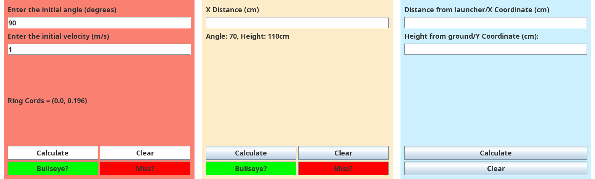

# highschool-physics

little swing apps I wrote for high school physics labs in 2022.

- `ring-of-fire/`: enter the launch angle and initial velocity, get the
  projectile coordinates for the ring of fire lab. got packaged into a
  windows exe with launch4j (config in `packaging/`, original 2022 jar in
  `dist/`).
- `physics-range-calculator/`: enter the target x distance, get the launch
  velocity you need at the fixed angle. the green `Bullseye?` and red
  `Miss?` buttons were meant to flash a goofily photshopped happy / mad reaction photo of my teacher
  depending on the shot lol. the pics are lost to time, the buttons remain.
  `ProjectilePrediction.java` is the earlier console version. the lab
  spreadsheets and writeups it was built alongside are in `docs/`.
- `ski-jump-predictor/`: launch point measurements in, landing math out.
  `Main.java` is a mid-rename snapshot that never compiled, kept as found.

archived from my old windows drive in 2026.
